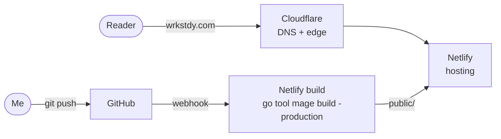

The blog works. It builds, it deploys, and you're reading it. Before I sink more time into the tooling or the styles, though, I want to step back and check that the basics are in place for something running in production --- even something as small as this.

Production readiness review is a real thing with a real checklist. This is the lightweight version: write down what "ready" means for this site, check each piece, and fix what's missing.

## What I knew going in, and what I didn't

Some of this was decided before I wrote a line of code. Netlify was always going to be the build and hosting target. It's what I've been reaching for with static sites for personal projects, and the skeleton came with a `netlify.toml` already in place.

Other parts I only figured out while making the list. The big one: I want Cloudflare in front of the site for networking. I've spent a lot of time with Akamai, and I'd like to learn another common edge CDN while the stakes are this low.

## The network, at a high level

Here's how a request gets to a page, and how a page gets built:

Two halves, really. On the read side, Cloudflare owns DNS for the domain and sits at the edge, and Netlify serves the files. On the write side, a push to GitHub kicks off a Netlify build, which runs the same Mage task I run locally and publishes `public/`.

### Networking with Cloudflare

Cloudflare is where most of the new-to-me learning happens. The pieces I needed to cover:

- **DNS.** Moving the domain's nameservers to Cloudflare and pointing the apex at Netlify.
- **Caching.** Deciding what the edge caches and for how long, and how that lines up with the headers Netlify already sends.

DNS was the easy part: the nameservers moved to Cloudflare, and the apex points at Netlify.

Caching was the interesting question. Netlify is a CDN too, so putting Cloudflare in front of it means two layers of caching to reason about. I could have spent a while working out how much each one should do, but I'm here to learn Cloudflare, not to tune two CDNs against each other. I also plan to proxy other projects on paths under wrkstdy.com, and that routing belongs at the edge anyway. So Cloudflare does the edge caching, and Netlify serves the files.

I started with simple defaults. Cloudflare caches HTML at the edge for a day and the hashed assets for a year. Anything with a status of 300 or above gets a much shorter TTL, so a redirect or a 404 doesn't stick around at the edge after I fix it.

Behind the edge, Netlify's headers tell browsers how long to keep things. Everything under `/assets/` (fonts, CSS, JS, icons) has a hashed name and a year-long `immutable` cache header. Their names change whenever their contents do, so there's nothing to invalidate.

HTML is different. Netlify sends `max-age=0` for pages by default, which I've loosened to an hour. That means a deploy can take up to an hour to reach someone who already has a page open, which is a fine trade for a blog. A day at the edge is the part I don't want to wait on, so a Netlify build plugin, [netlify-purge-cloudflare-on-deploy](https://github.com/chrism2671/netlify-purge-cloudflare-on-deploy), purges Cloudflare's cache after every production deploy. A new post shows up at the edge right away, not a day later. It's set up in `netlify.toml` to run for production only, so pushing to a pull request doesn't empty the cache for the live site.

### Builds in Netlify

The build side is in better shape. `netlify.toml` pins the Go version and runs `go tool mage build -production`, which runs `go vet` and the tests first and fails the deploy if either fails. Deploy previews and branch deploys get the same build with their own base URL, so links work on preview URLs too.

## The HTML itself

Next is the output: is the markup semantic, and is anything missing?

A quick look turned up a few gaps right away:

- **No favicon.** Every browser tab showed the default icon, and every page load logged a 404 for `/favicon.ico`.
- **No `robots.txt` or sitemap.** Hugo generated these for free. My generator doesn't, yet.
- **No 404 page.**

The favicon is the wordmark's `~/` in Fira Code SemiBold, outlined into an SVG that follows light and dark mode. Next to it there's an `apple-touch-icon` and a root `favicon.ico` for clients that still ask for one there.

The 404 page is a markdown file, `content/404.md`, that the generator writes to `/404.html`, which is where Netlify looks for a not-found page. It gets a `noindex` tag instead of a canonical URL, and a test makes sure it stays that way.

The structure itself is in decent shape: a `lang` attribute, a single `<main>`, a labeled `<nav>`, a canonical URL, and a description on every page. I still want to run each page through a validator and an accessibility checker instead of trusting a quick read.

## Assets, and what else loads

Assets already go through a small pipeline. Each file in `assets/` is written under a content-hashed name, with a Subresource Integrity hash for the `integrity` attribute. That covers cache busting.

It didn't minify anything, though. With one stylesheet and one small script, I didn't expect it to matter much, so I measured first. Gzipped, the stylesheet is 2.4 KB and my script is 0.7 KB. Minifying takes those to 2.2 KB and 0.6 KB. That's a few hundred bytes, small but free, so the pipeline now runs CSS and JS through [tdewolff/minify](https://github.com/tdewolff/minify) before hashing them. Minifying comes first so the hash and the integrity attribute match the bytes that are actually served.

The real weight is somewhere else. Diagrams like the one above load Mermaid from jsDelivr: about 208 KB gzipped, spread over 25-plus files. That's more than everything else on the page combined, and it comes from someone else's server. For now, Mermaid only loads on pages with a diagram.

Concatenating and serving Mermaid myself both point to the same thing: a proper build step for CSS and JavaScript. That's a bigger change than this pass, so I'm deferring concatenation until I add one, and I'll work out how to deliver Mermaid at the same time.

I also checked what loads that I didn't put there. Cloudflare turns on its Real User Monitoring by default, which adds a beacon script to every page. I may want those numbers later, but for now it's off.

## A first pass at CI

Until this pass, the only automated check was the one Netlify runs on deploy. That meant a broken test showed up as a failed deploy, not before it.

The first step was a GitHub Actions workflow on pull requests and pushes to `main`. It runs `go tool mage test` and a build with drafts, on the same Go version Netlify pins, so a failure shows up on the PR instead. Drafts are in that build on purpose: deploy previews include drafts too, so a post can be reviewed on its PR before it's published.

Branch protections on `main` back that up. Every change goes through a pull request, and both the CI job and Netlify's deploy preview build have to pass before it can merge. It's just me, so there are no required approvals.

## Things left to do

I'm leaving a few things for another day:

- **Accessibility.** Run every page through a validator and an accessibility checker, and fix what they find.
- **A sitemap and `robots.txt`.** Hugo generated these for free. My generator doesn't, yet.
- **Git hooks.** Run the same Mage checks before a commit or push, not just on the PR.
- **A build step for CSS and JS.** Concatenate assets, and serve Mermaid myself instead of from jsDelivr.

None of it is exciting, but all of it is the kind of thing that's easy to skip on a side project and annoying to find out about later. With the basics in place, I can get back to the parts I actually want to spend time on: the tooling and the styles.
