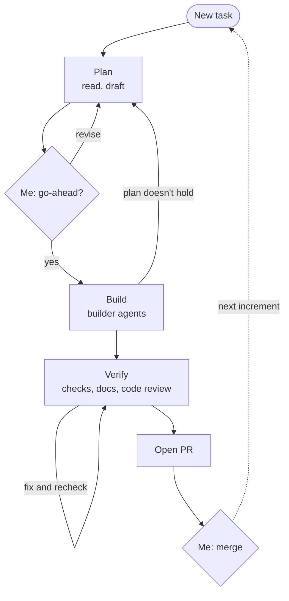

In my first post here, I said the next thing I wanted to try was playbooks and loops. Then I read the opening of Suraj Khaitan's [Stop Running Opus for Everything](https://dev.to/suraj_khaitan_f893c243958/stop-running-opus-for-everything-loop-engineering-and-the-multi-model-playbook-in-claude-code-dpd), and felt a little called out:

> There's a phrase making the rounds on X right now: loop engineering. "Stop prompting, start designing loops." Like most good ideas it's been repeated into mush — ask ten people what a "loop" is and you'll get ten answers.

I was one of the ten. The implementations I came across were agent platforms, a "factory" that takes tasks in and runs agents on them with nobody in between, and I'd been treating the factory as if it were the loop. What helped was simplifying: a loop is a standardized workflow, the same steps run the same way every time. The factory, I didn't want. The workflow, I did, and it allowed me to encode where I would get included in decisions.

It hasn't been long, but after a few days of working this way on tributary, the simpler version has held up. It's a single written workflow that AI follows on every task. Mine is a markdown file called a playbook: plan, build, verify, with a stop for my go-ahead before any file changes. I haven't run a full platform myself, so there may be things they do that I'm not getting.

This post covers what's in that playbook and the roles doc behind it, how it hands off the coding, and why it doesn't turn into a factory.

## Writing the steps down once

The playbook is a single file in tributary's docs, about 250 lines now. Every change goes through 3 phases, in order:

- Plan: read the docs and code for the area, restate the task, draft which files change and which tests and docs come with them, and list anything that would otherwise be a guess. Then stop and wait for my review and go-ahead.
- Build: make the change on a branch, inside what was agreed. If the plan stops holding, stop and check in instead of improvising.
- Verify: run the same steps CI runs, run the app, read the whole diff, check the docs, run a code review, and open a PR.

Here's the whole thing, with the 2 places it waits on me:

The go-ahead has no exceptions, even for a one-line fix. For the smallest changes that's a little heavy. But it's where most of my steering happens: a plan is cheap to change, and a finished diff isn't. It's the same plan → implement → review habit I already had. The difference is that I'm not the one walking each task through it anymore.

Two pieces of the shape came from Pranay Joshi's [How the Claude Code Team Actually Uses Claude Code](https://blog.vibecoder.me/how-claude-code-team-uses-claude-code): plan before any file is touched, and give AI a way to check its own work. The post calls the second "probably the most important thing," and it's why Verify runs the app and the code review, not just the tests.

> [!NOTE]
> Having the AI code review as a part of the verification step has been very helpful. I'm finding fewer nits once it is time for me to review, and on a team I would imagine this would help reduce the "[meat proxy](https://dontbeameatproxy.com/)" that team PR reviews can become.

That's what "first class citizen" means to me here. tributary was a fresh start, so I wanted my workflow baked in from the beginning, rather than bolted on once habits had already set. The docs in the repo are written for AI to read as much as for me, and they get updated in the same PR as the process they describe.

So far, the consistency has been a boon. A one-line fix and a feature spanning several PRs run through the process the same way: a plan to approve, the same stops, the same checks before a PR. I always know where a task is and what comes next.

## Who decides what

The playbook says *when* to stop. An earlier ai-collaboration doc I wrote says who decides once it does: a short table of roles at its core.

Currently it looks like this:

| Area | Developer | AI |
| --- | --- | --- |
| What gets built and in what order | Decides | Doesn't decide; may flag risks or dependencies |
| Understanding what users want | Decides | Takes it as given |
| Writing code | Reviews and ships | Writes the code, primary use of AI |
| Choosing tools and technology for new features | Makes the final call | Lays out options and trade-offs to support the call |
| Deployments | Manages | Helps only when asked |

That table is what makes the stops in the playbook work. Without it, "stop and check in" leaves AI guessing at what counts as worth stopping for. With it, the line is clear: product direction or a choice between technologies comes to me. A call about naming or where a file goes doesn't, so AI makes it, states the assumption, and notes it in the PR. One working agreement in the same doc sums it up: "ask a question only when the answer changes the code."

Anthropic's [AI-native SDLC playbook](https://academy.claude.com/courses/ai-native-sdlc-playbook/introduction) course says it more broadly: "Humans remain accountable for every decision that requires judgment." The course is written for teams, with 12 "plays" to adopt over time. The roles table is my solo-dev version.

## Handing off the coding

Build is handed to 2 subagents running on a smaller model: one for the Go backend, one for the frontend. The main session keeps everything around the coding: the plan, the branches, reviewing what comes back, and Verify. The subagents don't touch git, and they run one at a time, Go first, so the frontend is built against a finished API.

The split came from the same post that untangled loops for me: use the most capable model for judgment calls, and route routine work to smaller, faster ones. Planning and reviewing are the judgment here. Building from an approved brief is closer to routine.

The subagents haven't seen the conversation though, so the brief handed to them has to stand alone: the goal, the approved approach, the files to read and change, the tests and docs, the decisions that constrain it, and when to stop and report instead of guessing. Writing that brief is real work, so for rote changes and one-line fixes, the main session just makes the edit itself.

A third agent runs during Verify, and it's read-only. It compares the diff with the docs and reports mismatches, because the subagents building are more focused on their task and can miss these updates.

## Not a factory

What this setup doesn't do is run without me, and that's what keeps it from being a factory. There are loops inside it, since a plan revises until I approve it and a code review's fixes get checked again, but the outer loop, starting the next pass, is me. Every task waits at the plan for my go-ahead, and ends at an open PR that I merge myself. This is my chance for a full review, and merging deploys. Nothing picks the next task on its own.

Bigger work doesn't change that. A feature that spans several PRs gets a plan file in the repo, and each increment is one PR through the same steps, with a few lines of notes on where the next session picks up.

That's "human in the loop" baked into the workflow itself, rather than something I have to remember to step in for --- and that's the point. It's a solo project where I make every product call, and those 2 stops are exactly where I want a say. Everything between them, the order of steps, the checks, the handoffs, is in a file I can read, and change in a PR when it's wrong.

If loops and factories have blurred together for you the way they did for me, I'd start smaller: write down the steps you already walk AI through by hand, and ask it to follow them. That file is most of what I wanted from a loop, without the factory.
