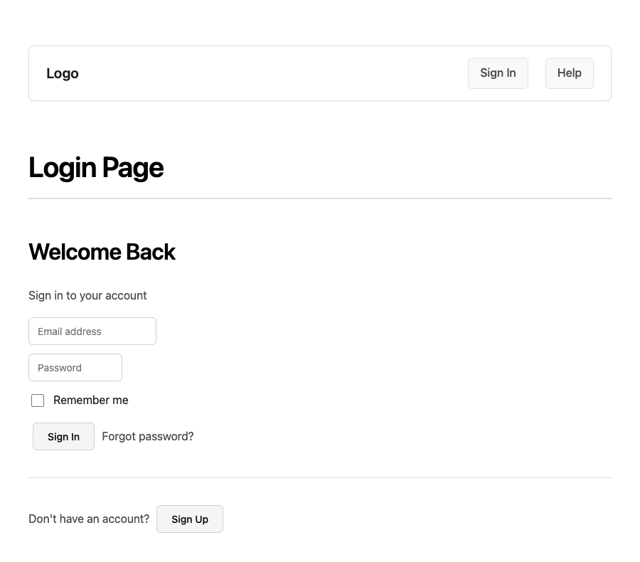

A plan that said "add a filter sidebar to the list page" read fine to me, and to AI. The generated code worked, but it wasn't the page I'd pictured. My reading of a layout description and AI's reading of it can both be reasonable, and still land on different pages.

Instances like this are a reason front end work has been a pain point in AI based workflows for me. We're agreeing on a plan that covers the data model and the shape of the code, but the layout can still be ambiguous.

I've been exploring tools for this, and using markdown-based wireframes has helped. Whenever layout is involved, there's a new step in my [playbook](/blog/leaning-in-ai-as-a-first-class-citizen/) to ask for a wireframe in the plan itself.

In the past, I'd have drawn a wireframe myself first. I'm showing my age here, but the last time I made wireframes it was in [Fireworks](https://en.wikipedia.org/wiki/Adobe_Fireworks). This time I'm looking to collaborate at a lower fidelity, where AI and I agree on the shape of a page before the details, and something markdown-based felt like the right fit, since the plan is already text.

> [!NOTE]
> For now I've been using [wiremd](https://wiremd.dev/). I also tried [PlantUML's Salt](https://plantuml.com/salt) and [Mockdown](https://www.mockdown.design/), but I preferred wiremd's simpler syntax and the simple theming of its built-in rendering. There are many similar tools, and what works best for you may vary.

This post covers why layout is hard to agree on in a written plan, what the wireframes look like, how they fit into my planning step, and where a design system would make them stronger.

## Why layout gets lost in a plan

A plan is good at *what*: which files change, which endpoint gets added, which tests come with it. It's much worse at *where* and *how*. "A form with a submit button" doesn't say whether the button sits under the fields or beside them, or whether the form shares the page with anything else. Those details are a big part of the user experience --- deciding how people take in what's on the page: what they see first, what order they read it in, what gets grouped together, what they have to scroll for. The same information, laid out two different ways, can be easy to scan or a wall to dig through.

In review I'd still catch the difference, but only then, once the code was written --- the most expensive place to catch it. A plan is cheap to change, and a finished diff isn't, so every layout fix at review meant a round of rework that a quick look at the plan could have saved. (it also meant a lot of me typing "no, the *other* left")

I tried describing layouts in more detail, and it didn't really help. The descriptions got long, they were hard to write, and they were easy to skim past. A bigger problem was that I was reading about a layout instead of looking at one. I'd much prefer to glance at the page visually and see if the plan matches my expectations.

## Wireframes in markdown

[wiremd](https://wiremd.dev/) takes a markdown file and renders it as a wireframe. Most of it is markdown I already know, plus a little extra syntax for UI pieces. Here's a login page from wiremd's own demo:

```markdown
[[ Logo | Sign In | Help ]]

# Login Page
## Welcome Back
Sign in to your account

[Email address___________]
[Password_______________]

[ ] Remember me

[Sign In] Forgot password?

---

Don't have an account? [Sign Up]
```

The source already has the shape of the page: a nav bar up top, 2 inputs stacked, a checkbox, and a button with a link beside it. Even the raw text gives me more of a picture than a description would.

The bigger gain is having a rendered version for review. wiremd renders it in several styles (sketch, clean, tailwind, and others) and has a watch mode and a VS Code preview, so I can look at the layout the way a user would see it, and judge whether the page reads in the right order.


The login page markdown from above, rendered with wiremd's clean style.

That gives me both halves. The wireframe is plain text, so it sits right in the plan, it diffs like anything else, and AI can write it as easily as it writes code. And it renders into something visual, which is what I need as the human reviewing it.

## Asking for wireframes in the plan

The change to my workflow is small. When a task touches layout, the plan includes a wireframe for each screen it changes. That's it.

What I get is a quick view of how the layout will be handled, before anything is built. If the filters are in the wrong place, I move them in the wireframe, or say where they belong, and the plan gets revised. It's the same plan, review, go-ahead step I already had, with one more thing in it to review.

It also keeps me in the role I want. I'm the one who decides, and the one who holds what the user actually needs. AI can lay out a reasonable page, but it doesn't know that people mostly come to this screen to do one thing, and that thing should be at the top. The wireframe is where I get to say so, in a form that's quick for me to change.

## Where a design system fits in

A wireframe only says so much on its own. "[Sign In]" is a button, but which button? For [tributary](https://tributary.observer/) I'm using [shadcn/ui](https://ui.shadcn.com/), so AI already knows the set of components it has to work with, and the wireframe maps onto them pretty directly.

I haven't done this part yet, but I expect bringing my own design system would make the wireframing process even stronger. If the wireframe's pieces line up with my own components, the gap between the sketch and the finished page gets smaller, and what gets built stays consistent with my brand and style rather than a default one.

If you've had a plan get built with an unexpected layout, I'd try asking for a wireframe next time. It's a small addition to the plan, and it moves the layout conversation to where it's cheapest to have.
