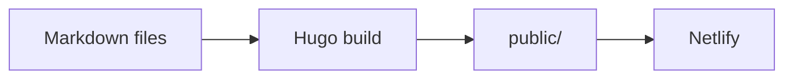

This site is built with [Hugo](https://gohugo.io) from plain markdown files
and deployed on Netlify. Posts are tagged, so writing and dev-log entries can
live side by side.

## Code

Fenced code blocks are highlighted in the browser by
[MicroLighter](https://github.com/davatron5000/microlighter):

```go
package main

import "fmt"

func main() {
	fmt.Println("hello from wrkstdy")
}
```

## Diagrams

A `mermaid` code block becomes a diagram:



That's it for now.
