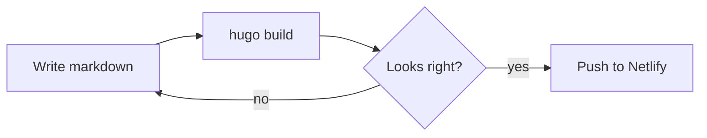
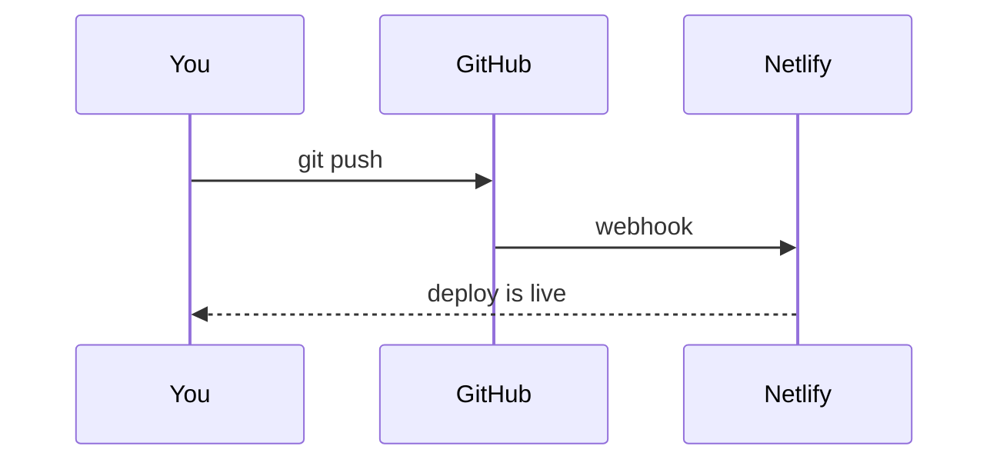

## Palette



## Type



# Heading one
## Heading two
### Heading three
#### Heading four

Body text is set in Fira Sans. It carries **bold**, *italic*, ~~strikethrough~~,
`inline code`, and [links](/). A footnote looks like this.[^1]

> A blockquote. Good for pulling out a line from somewhere else, or an aside
> that deserves a little room.

---

## Lists

- Unordered item
- Another item
  - A nested item
  - And one more
- Back to the top level

1. Ordered item
2. Second item
3. Third item

- [x] A finished task
- [ ] An open task

## Table

| Element | Font | Notes |
| --- | --- | --- |
| Body | Fira Sans | 17px, 1.65 line height |
| Headings | Fira Code | weight 500 |
| Code | Fira Code | ligatures on |

## Code

```go
// Go
func greet(name string) string {
	if name == "" {
		return "hello, stranger"
	}
	return fmt.Sprintf("hello, %s", name)
}
```

```js
// JavaScript
const posts = await fetch("/blog/index.xml").then((r) => r.text());
export const isDraft = (post) => post?.draft === true && !post.published;
```

```bash
# Shell
hugo new content blog/my-post.md
hugo server --buildDrafts
```

```css
/* CSS */
:root { --accent: light-dark(#3f6b3a, #9cc283); }
a:hover { color: var(--accent-2); }
```

```json
{ "title": "Hello, world", "tags": ["dev-log", "meta"], "draft": false }
```

```diff
- font-family: "IBM Plex Sans";
+ font-family: "Fira Sans";
```

```
A code block with no language stays plain.
```

## Diagrams





[^1]: Footnotes collect at the bottom of the page.