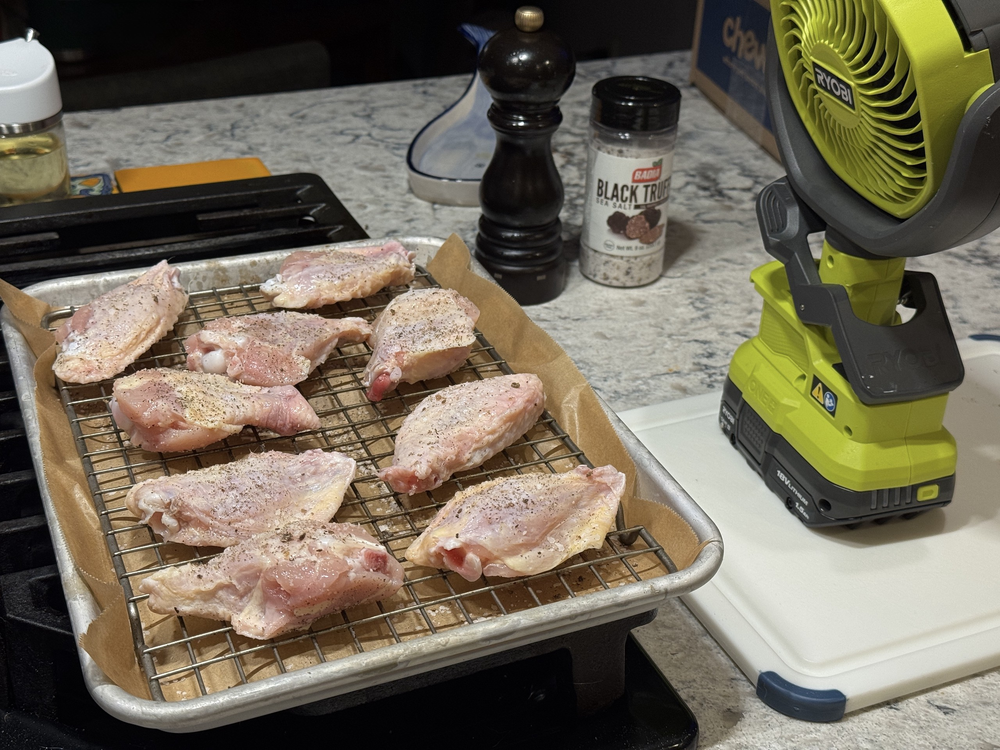
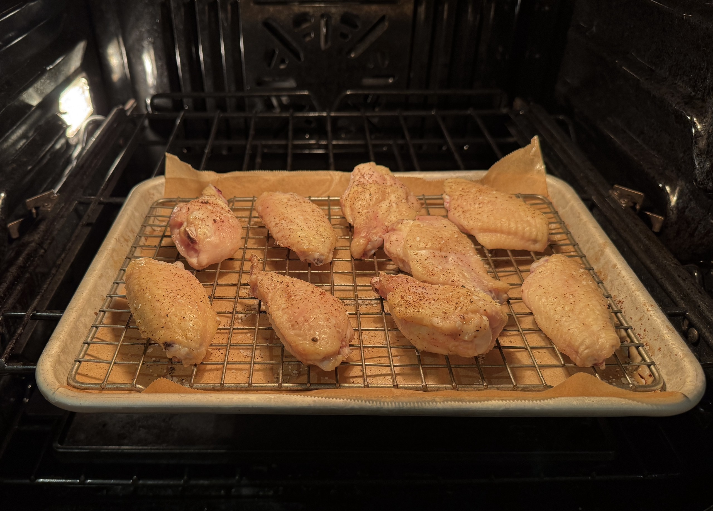
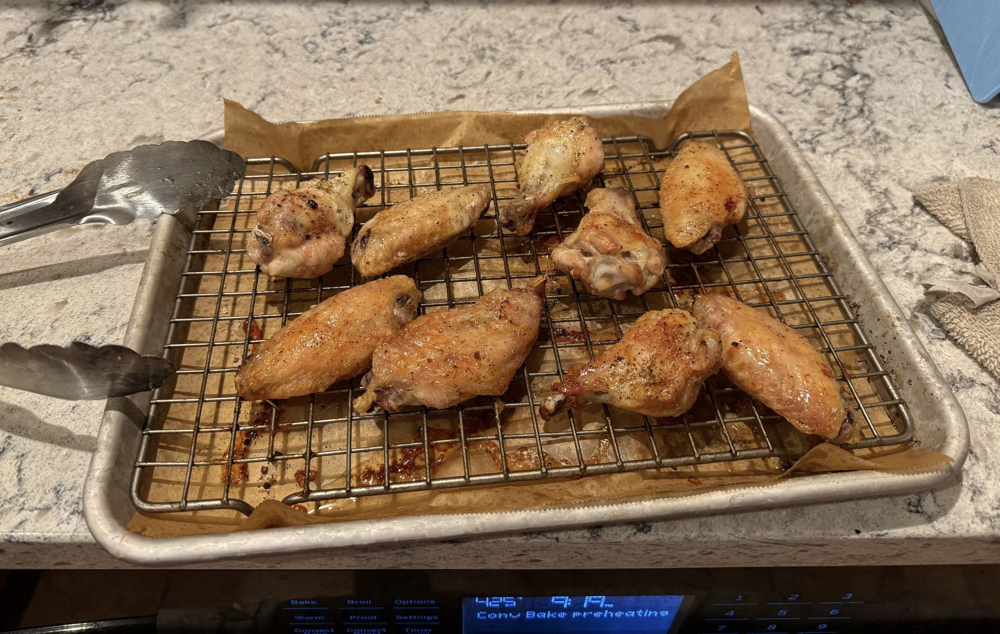
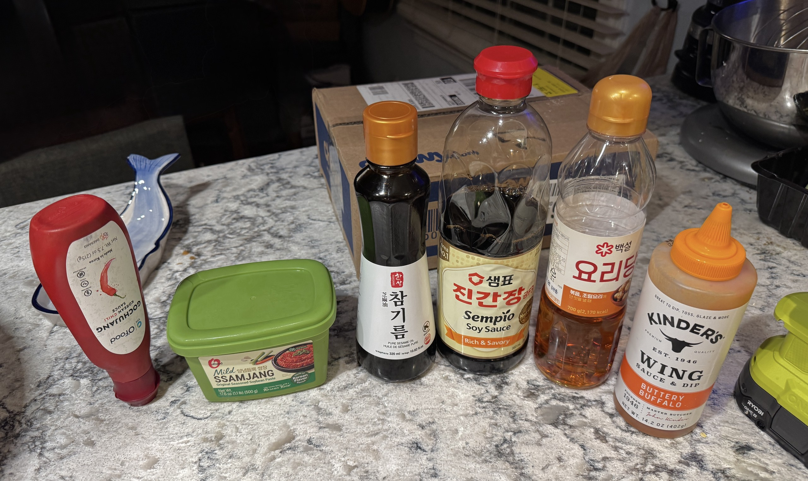
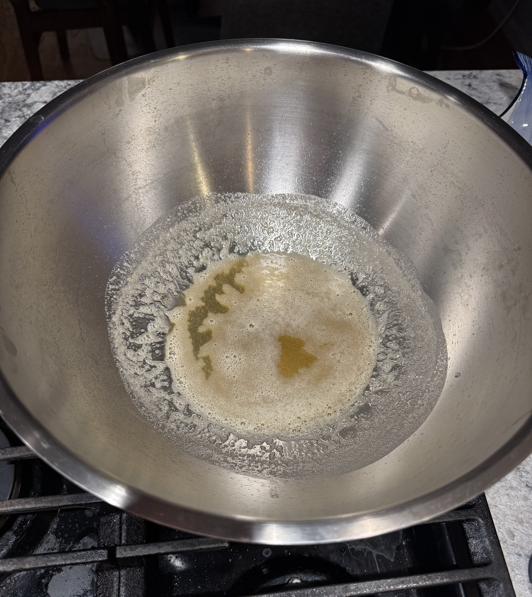
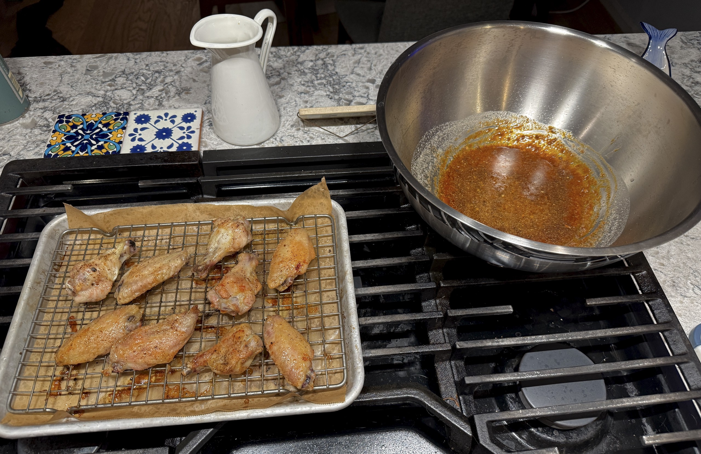
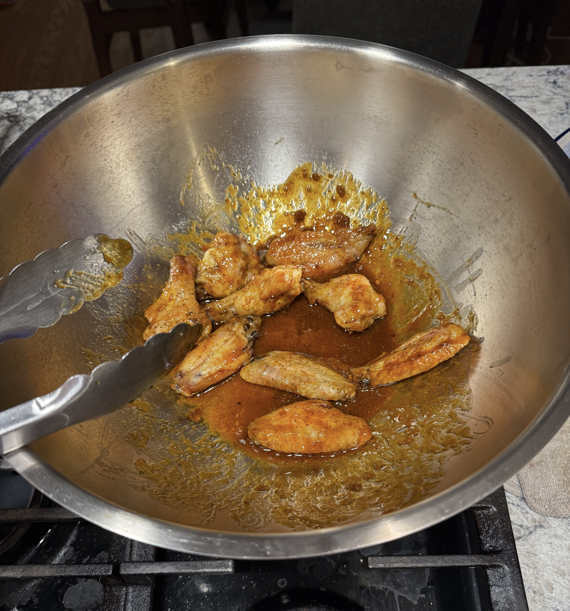

{loading=eager}
Out on the trail.

I was backpacking with a friend, and somewhere along the trail we got to talking about food. I mentioned I'd been working on a method for oven-baked wings that was working pretty well (something about camping made me want them). I don't have many recipes written down, though I have been meaning to start, so I put this one together for him.

## The recipe

```recipe
toss the wings in the sauce, and enjoy
  bake at 450°F convection until crispy, about 5 min
    bake at 425°F convection, 20 min
      bake at 365°F convection: 15 min fat side up, flip, 15 min more
        season on a wire rack, dry under a fan while the oven preheats
          chicken wings
          salt
          pepper
  stir together
    stir in, keep at a low simmer
      melt together
        a couple knobs of butter
        a splash of sesame oil
      a spoonful of ssamjang
      gochujang, to taste
      soy sauce
      oligo syrup
    buffalo wing sauce
```

## The process

Preheat the oven to 365°F on convection. While it heats, lay the wings out on a wire rack, salt and pepper them, and put a fan on them. The fan dries off the surface moisture, which helps them brown and crisp.


Salted, peppered, and drying under a fan while the oven preheats.

Once it's preheated, put the wings in fat side up for 15 minutes, then flip them and go another 15.


The first round at 365.

Pull the wings and preheat to 425°F on convection. When the preheat timer goes off, put them back in for 20 minutes.


Out between rounds while the oven climbs to 425.

About 5 minutes before that timer, start the sauce: melt a couple knobs of butter with a splash of sesame oil, then add a spoonful of ssamjang, gochujang to taste for heat, some soy sauce and some oligo syrup.


The sauce lineup.


Butter and sesame oil going.

Pull the wings again and preheat to 450°F. Keep the sauce at a low simmer. Give the wings 5 minutes at 450, and while they go, stir the wing sauce into the pan.


Crispy wings, sauce ready.

Once the wings are crispy, toss them in the sauce, and enjoy.


Into the sauce.
