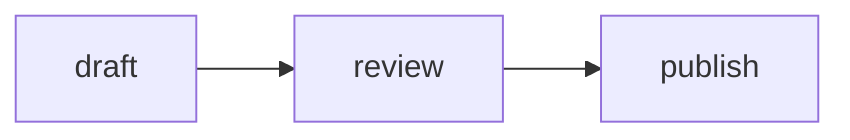

# Code blocks

Fenced code blocks render as plain `<pre><code class="language-x">`, and [MicroLighter](https://github.com/davatron5000/microlighter) colors them in the browser. Each language's grammar is fetched only on pages that use it.

````markdown
```go
x := 1 < 2
```
````

A fence with no language is left uncolored.

## Language aliases

A few fence names are mapped to the grammar MicroLighter knows them by:

| Fence | Grammar |
| --- | --- |
| `diff`, `patch` | `git-diff` |
| `golang` | `go` |
| `console` | `bash` |

Add more in `langAliases` in `internal/site/markdown.go`.

## Collapsed blocks

A `summary="..."` after the language collapses the block into a `<details>`, closed until clicked, with the summary as its label:

````markdown
```markdown summary="The full output of go tool plugh context for this post"
# Voice for blog (content/blog/)
...
```
````

Use it for long output the reader might want but doesn't need to read through: a full log, generated config, or a command's output. Open, the block is capped at 32rem tall and scrolls inside that.

The summary is plain text, and HTML in it is escaped. It can't contain a `"`.

## Mermaid

A ` ```mermaid ` block renders as a diagram:

````markdown

````

Mermaid is bundled from npm and loads only on pages that have a diagram. `summary="..."` doesn't apply to these.

## Recipes

A ` ```recipe ` block renders as a recipe table. See [recipes.md](recipes.md).

Code: `codeBlockRenderer` in `internal/site/markdown.go`. Styles: `pre` and `.code-details` in `assets/css/base/elements.css`.
